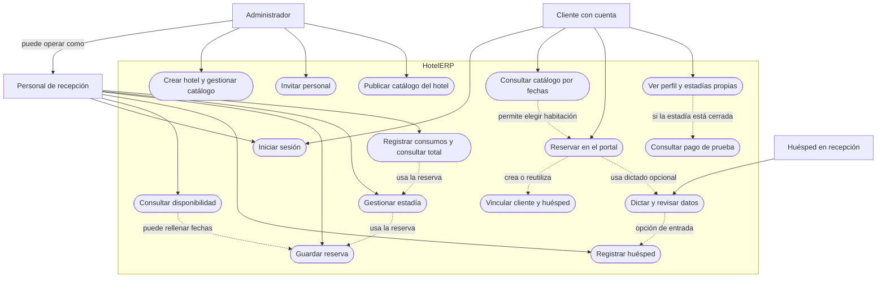
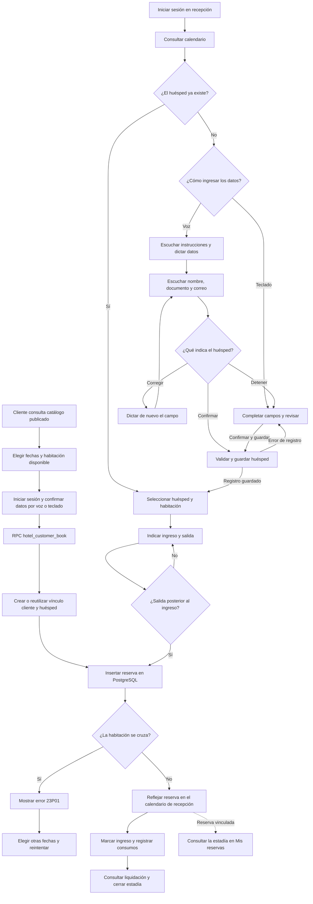
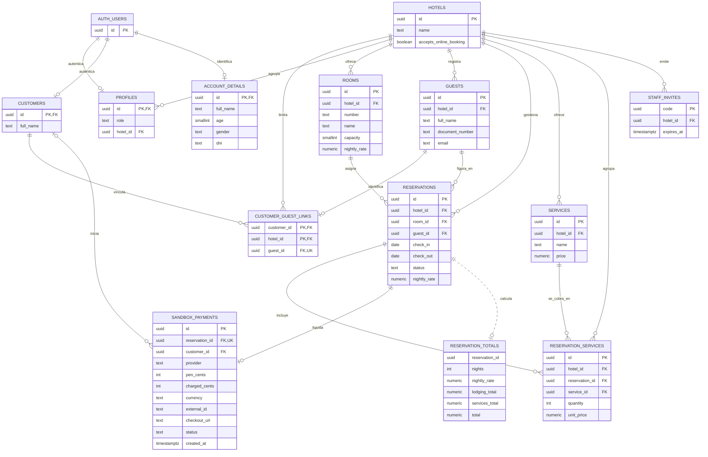
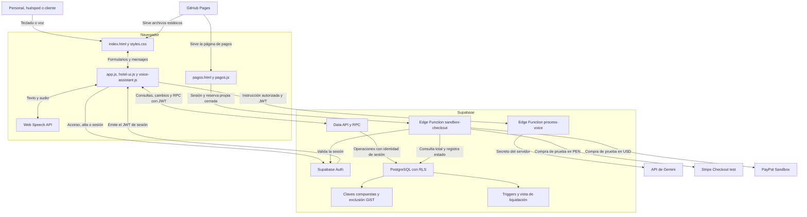

# HotelERP · Diagramas técnicos y sustentación individual

**Mini-ERP Empresarial · Caso 3: Hotel**

HotelERP reúne el registro de huéspedes, el calendario de ocupación, las reservas y la liquidación en el panel de recepción. Los diagramas se basan en el código de la rama principal y en el exporte de columnas, restricciones y políticas del proyecto Supabase. Las definiciones de funciones, vistas y políticas se explican según las migraciones del repositorio.

## 1. Casos de uso

El formulario de alta llama a `hotel_finish_registration`, que guarda la ficha privada y crea el perfil. El administrador puede publicar la disponibilidad de su hotel, administrar habitaciones y servicios y solicitar invitaciones al servidor con `hotel_invite_staff`. El personal, con rol `receptionist`, trabaja sobre el hotel de su perfil. El huésped puede dictar datos en el formulario de recepción bajo la sesión del operador. El cliente autenticado consulta disponibilidad, crea reservas y verifica sus propias estadías. Al reservar, el cliente selecciona una habitación publicada y el servidor crea o reutiliza el vínculo con el huésped del hotel. El registro por teclado y el dictado alimentan el mismo formulario.

## 2. Proceso de registro, reserva y liquidación

El calendario presenta siete noches, con nombre textual para cada estado. Una casilla libre preselecciona habitación e ingreso, propone una noche y mueve el foco al selector de huésped. Una casilla con reserva abre su detalle. En el dictado, `listen()` reproduce la instrucción antes de iniciar el reconocimiento en `es-PE`. `captureVoiceField()` recibe el correo dictado. El normalizador elimina tildes, convierte «arroba», «punto», «guion» y «guion bajo», y completa dominios frecuentes como Gmail. El campo puede omitirse con «sin correo». `review()` lee los tres datos. Al oír «corregir correo», «corregir nombre» o «corregir documento», limpia el campo, vuelve a escucharlo y lee el resumen completo. «Guardar» o «confirmar» envía el formulario. El fallo al abrir el micrófono se anuncia con una alerta y permite continuar escribiendo. `requestSubmit()` conserva la validación nativa y comparte el envío del formulario de teclado.

Si la salida es anterior o igual al ingreso, el frontend detiene el envío. PostgreSQL comprueba las fechas y ejecuta la restricción GiST al insertar. Ante un cruce, `explain()` traduce `23P01` a un mensaje claro. Si se guarda la reserva, la interfaz actualiza el calendario y abre la liquidación correspondiente. El panel permite marcar ingreso o cancelar desde «Reservada», y cerrar desde «Ocupada».

## 3. Entidad–relación

El esquema contiene 12 tablas públicas y la vista `reservation_totals`. `auth.users` pertenece a un esquema separado. Las claves `profiles.id`, `customers.id` y `account_details.id` referencian esa identidad. La ficha privada se lee con la cuenta titular. `customer_guest_links` vincula al cliente con un huésped del mismo hotel y se gestiona por RPC. `sandbox_payments.reservation_id` es único y su `customer_id` puede quedar nulo si se elimina el cliente.

| Regla | Implementación |
| --- | --- |
| Identidad operativa dentro del hotel | Únicos `(hotel_id, number)` en habitaciones, `(hotel_id, document_number)` en huéspedes y `(hotel_id, name)` en servicios. |
| Relaciones dentro del hotel | `reservations` usa las referencias compuestas `(hotel_id, room_id)` y `(hotel_id, guest_id)`. `reservation_services` usa `(hotel_id, reservation_id)` y `(hotel_id, service_id)`. Las cuatro apuntan al par `(hotel_id, id)` de su tabla padre. |
| Consumos de la reserva | `reservation_services` vincula una reserva con un servicio y conserva cantidad y precio unitario. Puede haber varias líneas. |
| Liquidación | `reservation_totals` es una vista con una fila calculada por reserva no cancelada. Su enlace en el diagrama representa la derivación de datos. |
| Disponibilidad | `reservations_no_overlap` aplica exclusión GiST sobre `room_id` y el rango `[ingreso, salida)` en reservas no canceladas. |

## 4. Arquitectura

GitHub Pages entrega los archivos. El navegador usa Supabase Auth para inicio de sesión con correo y contraseña, con Google como opción si el proveedor está habilitado. `supabase-js` comunica la identidad de sesión a la Data API, y el frontend consulta el perfil para mostrar el panel correspondiente. La base de datos aplica la autorización. Las políticas del repositorio obtienen el hotel desde el perfil del usuario autenticado, permiten al personal operar dentro de su hotel y limitan los cambios de catálogo al administrador. Las migraciones también restringen la ficha privada y los pagos al titular, y reservan la gestión del vínculo cliente-huésped a las funciones del servidor.

La voz usa `SpeechRecognition` o `webkitSpeechRecognition` para reconocer el dictado y `SpeechSynthesisUtterance` para leer instrucciones y datos. El reconocimiento depende del navegador, de su servicio de voz y del permiso de micrófono. HTML mantiene etiquetas y botones nativos, y `app.js` publica estados y errores mediante `aria-live`. PostgreSQL conserva los importes cuando crea una reserva o un consumo y calcula la liquidación con la vista. El JavaScript consulta esa vista y presenta los importes en soles. Gemini es opcional y clasifica instrucciones de revisión. Para pagos de prueba, `sandbox-checkout` comprueba la identidad y el total de la estadía cerrada. Stripe usa PEN y PayPal Sandbox usa USD con una cotización de referencia. Las credenciales de los proveedores se configuran en Supabase.

## 5. Guía de sustentación individual

### Preparación

1. Entra a [HotelERP](https://amadorjara-alt.github.io/HotelERP/) con una cuenta confirmada. Usa la cuenta administradora de **Rodolfo**. Si preparas otro entorno de ensayo, puedes crear **Hotel Demo ERP** desde el alta de personal.
2. En el SQL Editor del proyecto `ynnulzfgsfkojvgbhgua`, ejecuta [HotelERP_seed.sql](HotelERP_seed.sql). El script prioriza **Rodolfo**, acepta **Hotel Demo ERP** como alternativa y habilita el catálogo público del hotel seleccionado. Si el nombre es ambiguo o deseas otro hotel, usa su UUID en `hotel_objetivo`. Regresa a la aplicación y pulsa **Actualizar** en el calendario.
3. Antes de presentar, ensaya con el mismo navegador y micrófono. Comprueba que puedas recorrer el formulario con Tab y Shift+Tab, activar botones con Enter o Espacio y guardar sin hablar. Con un lector de pantalla, escucha las etiquetas y los anuncios de estado. Si el micrófono falla durante la exposición, muestra el camino por teclado y explica el flujo de voz con el diagrama.

### Caso exitoso · 3 minutos

1. **Explica el problema.** «HotelERP organiza el trabajo de recepción y evita que dos huéspedes queden asignados a la misma habitación durante las mismas noches».
2. **Muestra el calendario.** Señala una casilla «Libre» y una «Reservada» u «Ocupada». Tras el primer seed, la DEMO-101 contiene una estadía ocupada que incluye el día de la carga.
3. **Registra un huésped.** Activa **Iniciar registro por voz**, dicta «Lucía Demo», un documento ficticio que no hayas usado y «lucia arroba ejemplo punto com». En el resumen di «corregir correo», espera a que el sistema pida el nuevo correo y dicta «lucia demo arroba gmail». Comprueba que el resumen actualizado incluye `luciademo@gmail.com`. Di «guardar». El aviso esperado es «Huésped registrado. Ya puedes crear su reserva». El selector de huésped queda preseleccionado.
4. **Crea una reserva de tres noches.** Selecciona **DEMO-105** y tres noches seguidas libres. En una carga nueva, puedes usar ingreso mañana y salida cuatro días desde hoy. Revisa el calendario si ya ensayaste con esas fechas. Pulsa **Guardar reserva**. Comprueba que el calendario cambie a «Reservada» y que la liquidación muestre la reserva recién guardada.
5. **Liquida la estadía.** Pulsa **Marcar ingreso**. Registra dos unidades de **Demo Desayuno** y una de **Demo Lavandería**. Con las tarifas originales del seed, el resultado es **3 × S/ 390 = S/ 1 170** de alojamiento y **2 × S/ 35 + S/ 25 = S/ 95** de servicios. El total es **S/ 1 265**. Después de demostrar el conflicto, pulsa **Cerrar estadía** para ver el cambio a «Finalizada».

### Error controlado · 1 minuto

1. Con la reserva anterior todavía vigente, abre **Nueva reserva**. Elige otro huésped del seed, la misma habitación y un ingreso un día después del ingreso original. Usa la misma salida. Completa todo desde el formulario de reservas.
2. Pulsa **Guardar reserva**. El aviso esperado es **«La habitación ya está reservada en parte de ese período. Elige otras fechas.»** La nueva reserva queda sin guardar y la original sigue en el calendario.
3. Explica que la exclusión se aplica en PostgreSQL durante la escritura. Las fechas usan un intervalo semiabierto. El día de salida puede ser el ingreso de otra reserva si el resto de sus noches está libre. En dos envíos simultáneos incompatibles, PostgreSQL impide que ambos se confirmen.

### Portal del cliente · 2 minutos

1. Abre **Soy cliente** en otra sesión. Usa una cuenta de cliente confirmada y un documento ficticio distinto de los que ya registraste en recepción.
2. Consulta fechas, selecciona una habitación publicada de **Rodolfo** o **Hotel Demo ERP** y confirma la reserva. Puedes dictar y corregir el correo antes de enviarla. Ve a **Mis reservas**.
3. Regresa a recepción y pulsa **Actualizar**. Comprueba que el número de habitación y las fechas coinciden con las del portal.
4. Si vas a mostrar pagos de prueba, registra los consumos y cierra esa estadía desde recepción. En el portal, abre **Consultar pago de prueba**. Para mostrar Stripe o PayPal se necesita el entorno de prueba correspondiente configurado en Supabase.

### Preguntas técnicas del docente

| Pregunta | Respuesta basada en la implementación |
| --- | --- |
| ¿Qué evita una doble reserva simultánea? | `reservations_no_overlap` usa `EXCLUDE USING gist (room_id WITH =, daterange(check_in, check_out, '[)') WITH &&) WHERE (status <> 'cancelled')`. Al rechazar el cruce, PostgreSQL devuelve `23P01` y `explain()` muestra el mensaje de disponibilidad. |
| ¿Cómo calculan la liquidación? | La vista `reservation_totals` calcula `check_out - check_in`, multiplica las noches por la tarifa capturada y suma `quantity * unit_price` por consumo. Usa cero cuando no hay servicios y excluye las reservas canceladas. |
| ¿Qué pasa si cambia una tarifa? | Los triggers `hotel_snapshot_room_rate` y `hotel_snapshot_service_price` copian la tarifa y el precio al insertar. El monto histórico se calcula con esos valores guardados. |
| ¿Cómo aíslan los hoteles? | Las políticas consultan el hotel del perfil autenticado. Las claves foráneas compuestas exigen además que habitación, huésped, servicio y reserva pertenezcan al hotel de la operación. |
| ¿Qué diferencia hay entre cliente y huésped? | `customers` guarda el perfil de una cuenta autenticada. `guests` contiene los datos operativos que registra recepción. `reservations` referencia a `guests`. |
| ¿Dónde se procesa la voz? | `listen()` y `speak()` invocan la Web Speech API. `readback()` genera el resumen. `review()` interpreta la confirmación o el campo a corregir. Al confirmar, el navegador envía los valores del formulario a Supabase. |
| ¿Cómo se usa sin micrófono? | Los campos tienen etiquetas HTML y los controles son botones. El usuario puede editar los valores con teclado y enviar el mismo formulario. Los avisos se publican como estado o alerta según el tipo de mensaje. |
| ¿Qué permite el modo cliente? | Permite filtrar el catálogo publicado, reservar, consultar el perfil y ver las estadías y liquidaciones propias. El vínculo cliente-huésped limita qué reservas aparecen en el portal. |

### Código de referencia

- [Frontend de recepción](app.js)
- [Dictado, corrección y alertas](voice-assistant.js)
- [Catálogo, portal y reservas vinculadas](hotel-ui.js)
- [Pago de prueba](supabase/functions/sandbox-checkout/index.js)
- [Formulario y estructura semántica](index.html)
- [Tablas, exclusión y liquidación](supabase/migrations/202611200001_hotel_erp_initial_schema.sql)
- [Hoteles, permisos y registro de usuarios](supabase/migrations/202611200002_hotel_tenants_and_customer_registration.sql)

## Portal público y reservas vinculadas

- `customer_guest_links` tiene clave compuesta `customer_id, hotel_id` y referencia al huésped del mismo hotel. `hotel_customer_stays` filtra estas vinculaciones por el usuario autenticado. Un cliente no puede apropiarse de un documento ya registrado por recepción.
- `hotel_public_catalog` sirve capacidad, tarifa y disponibilidad de habitaciones publicadas. La confirmación ejecuta `hotel_customer_book` de forma transaccional y utiliza la misma restricción GiST que recepción.
- La Edge Function `process-voice` autentica la cuenta, verifica su perfil y envía instrucciones autorizadas a Gemini con un secreto del servidor. Los comandos explícitos siguen disponibles con Web Speech API. El motor de IA no confirma la reserva por cuenta del usuario.

### Preguntas para defender

**¿Cómo se refleja la reserva del cliente en recepción?** El portal llama al RPC de reserva con una sesión válida. El RPC enlaza el huésped del cliente con el hotel y escribe en la misma tabla `reservations` que consulta el calendario administrativo.

**¿Qué evita que una fecha modificada invada otra reserva?** La misma restricción GiST se evalúa al hacer un UPDATE. El formulario solo permite editar pendientes y usa los datos anteriores como condición para evitar reemplazar otra edición.

**¿Qué pasa si falla Gemini o el micrófono?** Gemini es opcional. El reconocimiento del navegador permite usar comandos explícitos. Ante un fallo de micrófono, los datos se pueden escribir y confirmar desde el mismo formulario.
